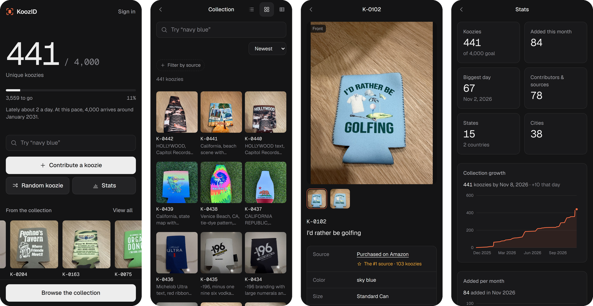

# KoozID

Photo search for a world-record koozie collection. Runs for $0/month on Cloudflare + Gemini.

**Point a phone at a koozie and find out in seconds whether it's already in the collection.**

Live at **[koozid.com](https://koozid.com)** · Runs for **$0/month** on Cloudflare + Gemini

<p align="center">
  
</p>

## The story

Bobby is going for the world record for the largest koozie collection: 4,000 unique ones. Past a few hundred, one question gets hard to answer, whether you're Bobby at a market table or one of the dozens of people sending him koozies from across the country: *is this koozie already in the collection?*

So I built KoozID. Take a photo of a koozie and AI image search shows the closest matches already in the collection. If it's new, the information to catalog it is written for you. Anyone can follow along publicly as the count climbs, browse every koozie, and send one in to be part of the record.

## Highlights

- **Intelligent photo search.** Multimodal embeddings find a koozie from a photo of its front or back.
- **$0 to run.** Every service sits inside a free tier, with room for about 9,700 photos before anything costs money.
- **AI-written descriptions** in Bobby's tone, so the catalogue stays consistent.
- **A count you can trust.** Saves are atomic and idempotent, so a double tap never counts a koozie twice.
- **A public site that can't leak.** Guests get a separate read-only API. The private side for him updating the collection sits behind login.
- **Tested and measured.** 72 tests run in the real Workers runtime, and search accuracy was benchmarked before launch.

## Built for $0

| What | Service |
|---|---|
| App, API, scheduled jobs | Cloudflare Workers |
| Database | Cloudflare D1 (SQLite) |
| Photos | Cloudflare R2 |
| Image search | Cloudflare Vectorize |
| Embeddings + descriptions | Google Gemini API |
| Login | Cloudflare Access |
| Email | Resend |

Staying free shaped most of the design:

- **Smaller vectors.** Shrinking image embeddings from 3,072 to 512 dimensions lost no accuracy in testing. It also fits about 6x more photos under the free search index cap.
- **The phone does the heavy lifting.** The free tier allows only 10 ms of CPU per request, so the phone resizes photos before upload. That also strips GPS location data.
- **AI failures are expected.** Free AI models get overloaded. The app falls back to backup models, and no save ever waits on AI.

## How well it works

| Search approach | Right koozie ranked first | Right koozie in top 5 |
|---|---|---|
| Simple pixel comparison (baseline) | 50% | 88% |
| **KoozID (Gemini embeddings)** | **96%** | **100%** |

The benchmark is built to be hard. It includes look-alikes such as the same logo on a different color.

## Stack

TypeScript · React 19 · Vite · Hono · Cloudflare Workers, D1, R2, Vectorize, Access · Gemini · Vitest

## Learn more

- [Architecture and design decisions](docs/ARCHITECTURE.md)
- [Cost breakdown and free-tier math](docs/COSTS.md)
- [How search accuracy was measured](docs/EVALUATION.md)
- [Deploying your own copy](docs/DEPLOYMENT.md)

<details>
<summary>Run it locally (no accounts needed)</summary>

```sh
cd app
npm install
cp .dev.vars.example .dev.vars
npm run db:migrate:local
npm run dev                # http://localhost:5173
npm test
```

Local dev uses a mock AI. For real image search, set `AI_PROVIDER=gemini` and a free `GEMINI_API_KEY` from Google AI Studio.
</details>

---

Questions? Email me at [hello@alexholland.tech](mailto:hello@alexholland.tech).

<sub>This repo is a public snapshot of a private project. Account IDs and personal details have been replaced with placeholders.</sub>
